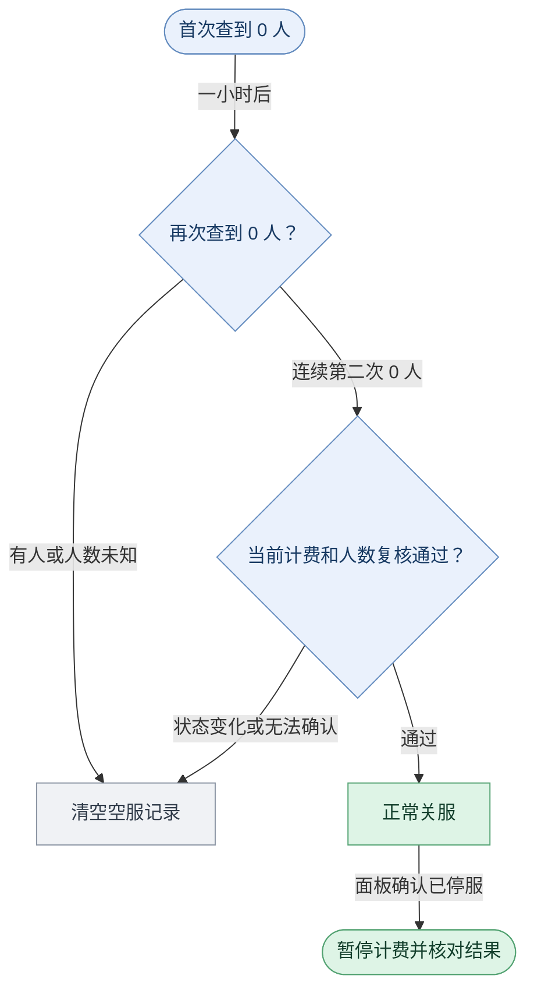

<div align="center">
  <h1>麦块计时卡自动关服</h1>
  <p><strong>玩完直接退游戏，空服到点自动关服、暂停计费。</strong></p>
  <p>
    <a href="https://github.com/shortFisherman/minekuai-idle-stop/actions/workflows/ci.yml"></a>
    <a href="LICENSE"></a>
  </p>
  <p>
    <a href="#快速开始">快速开始</a> ·
    <a href="#自动关停怎么判断">关停规则</a> ·
    <a href="#保活与冷备份">保活与备份</a> ·
    <a href="#查看状态与排查">查看状态</a>
  </p>
</div>

适用于麦块联机的 **Minecraft Java 版计时卡服**。把程序装到 Linux VPS 后，你照常在麦块面板开服。VPS 可以监控整个账号的计时卡实例，自己的电脑关机后也能继续运行。

| 功能 | 什么时候运行 | 会做什么 |
| :--- | :--- | :--- |
| **空服关停** | 推荐每小时检查，连续两次查到 0 人 | 复核在线人数和当前计费，确认游戏服停稳后再暂停计费 |
| **计时卡保活** · 可选 | 暂停计费满 6 天 | 短暂恢复计费，游戏服保持关闭，随后复核停费 |
| **整服冷备份** · 可选 | 每天北京时间 02:00 检查，备份约每周更新 | 停服下打包、下载并校验整服 ZIP，每台只保留最新一份 |

## 快速开始

需要一台使用 **systemd** 的 Linux VPS，能访问麦块面板和游戏服。游戏服需要开启多人游戏列表中的状态查询。以下以 Ubuntu 24.04 为例。

### 1. 安装

```bash
sudo apt install git python3 python3-venv
git clone https://github.com/shortFisherman/minekuai-idle-stop.git
cd minekuai-idle-stop
sudo bash install.sh
sudoedit /etc/minekuai-stop/config.json
```

<details>
<summary>VPS 连不上 GitHub 或 PyPI</summary>

在能联网的电脑上下载仓库源码，在源码目录下载依赖。

```bash
python -m pip download --only-binary=:all: --platform any -r requirements.txt -d wheelhouse
```

将源码和 `wheelhouse` 一起上传到 VPS。在 VPS 的源码目录执行安装，再继续配置。

```bash
sudo env WHEEL_DIR="$PWD/wheelhouse" bash install.sh
sudoedit /etc/minekuai-stop/config.json
```

</details>

### 2. 配置实例

把 `/etc/minekuai-stop/config.json` 改成下面这样，即可按推荐的节奏监控账号下所有计时卡实例。

```json
{
  "scope": "account",
  "poll_seconds": 3600,
  "idle_samples": 2
}
```

只想管一台服时，按 [单实例配置示例](config.example.json) 填。实例 ID 是麦块控制台地址中 `/server/` 后的 8 位字符。联机地址和端口要填同一台服。

### 3. 授权、检查并启动

在浏览器登录麦块，打开开发者工具，在「应用 → Cookie → https://minekuai.com」中找到 `Admin-Token`。在 VPS 上运行下面第一条命令，按提示将 Cookie 的值粘贴到隐藏输入框。这个值相当于账号的登录凭据。

```bash
sudo /opt/minekuai-stop/venv/bin/python /opt/minekuai-stop/authorize.py
sudo /opt/minekuai-stop/venv/bin/python /opt/minekuai-stop/monitor.py --check
sudo systemctl enable --now minekuai-stop.service
```

`--check` 会显示实例的计费和人数检查结果。确认识别到了要监控的实例，再启用服务。VPS 重启后，监控也会自动启动。

## 自动关停怎么判断

账号模式平时直接查游戏服人数。达到空服条件后，才为这次关服访问麦块面板。初始化、手动刷新名单、到期保活和冷备份也会访问面板。



按每小时一查的配置，通常从空服到发起关服约 **1～2 小时**。游戏服无响应时，人数状态为未知。手动关服时，记得也在麦块面板暂停计费。

## 保活与冷备份

**保活。** 在配置中添加 `"keepalive_days": 6`，然后重启监控服务。账号模式下默认覆盖全部计时卡实例，也可以用 `keepalive_instances` 列出需要保活的实例 ID。程序根据麦块的停费记录判断是否到期，保活时只操作计费。

**冷备份。** VPS 每天凌晨 2 点先检查本地记录。轮到某个实例备份时，程序会在原本已经暂停计费、游戏服保持关闭的情况下，临时恢复计费，并调用麦块文件管理打包整服。ZIP 下载并校验通过后才替换旧档，随后清理面板上的临时包并核对停费。启用方法、归档位置和回档步骤见 [整服冷备份说明](BACKUP.md)。

## 查看状态与排查

```bash
sudo systemctl status minekuai-stop.service
sudo /opt/minekuai-stop/venv/bin/python /opt/minekuai-stop/status.py
sudo journalctl -u minekuai-stop.service -n 50 --no-pager
```

`status.py` 只读 VPS 上的运行记录，输出最近的人数检查、保活安排、逐实例备份日期及尚未确认的计费操作。具体的失败原因在服务日志里。

| 遇到的情况 | 怎么处理 |
| :--- | :--- |
| 新建了实例，想立即纳入监控 | 将启动前检查命令中的 `--check` 改为 `--refresh-instances`。到期保活和冷备份也会顺手更新名单。 |
| 想观察空服判断 | 启动服务前，将检查命令中的 `--check` 改为 `--dry-run`。观察模式只检查，按 Ctrl+C 退出。 |
| 今天打算留着空服 | 用 `sudo systemctl stop minekuai-stop.service` 暂停监控，之后用 `sudo systemctl start minekuai-stop.service` 恢复。 |
| 麦块拒绝了当前会话 | 先在面板核对计费状态，再重新登录、运行授权命令并重启监控服务。自动任务会停用已被拒绝的会话。 |
| 更新程序 | 更新源码、重新执行安装脚本，再重启监控服务。启用了冷备份时加上 `--cold-backup`。已有配置与授权会保留。 |

## 许可

使用 [MIT 许可证](LICENSE)。麦块接口的早期实现参考了 [minekuai-qqbot](https://github.com/LookO-666/minekuai-qqbot)。
