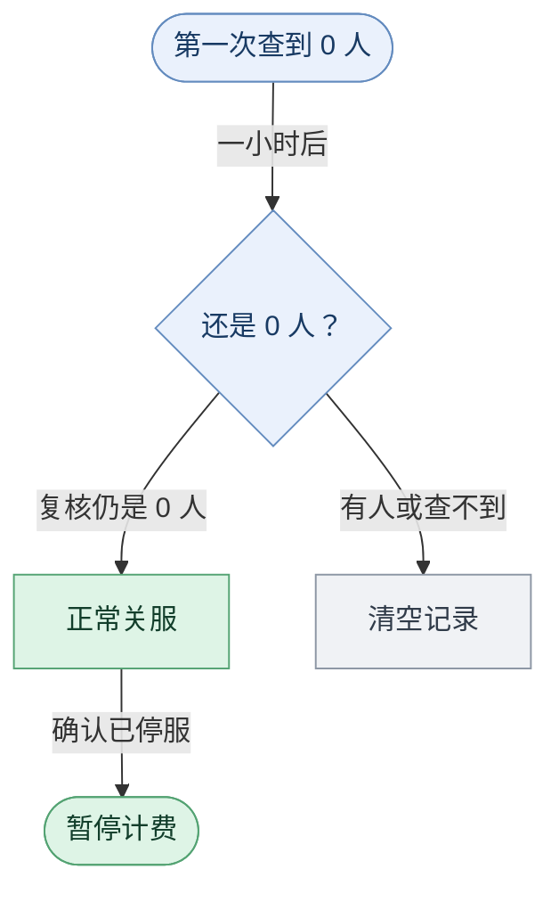

# 麦块计时卡自动关服

玩完退了游戏，忘了去麦块暂停计费，计时卡就会一直扣。把脚本挂在 VPS 上，空服时它会帮你关服和停费。下次照常在麦块网页开服，脚本会自己发现，电脑也不用一直开着。

| 空服关停 | 计时卡保活（可选） | 整服备份（可选） |
| :---: | :---: | :---: |
| 每小时查一次<br>连续两次 0 人才关服 | 暂停满 6 天<br>短暂开一下计费 | 约每周更新<br>每台只留最新一份 |

## 退了游戏以后



通常从空服到发起关服要 **1～2 小时**，之后还要等麦块确认。如果你手动关服，记得顺手暂停计费，停服后脚本可能查不到人数。

## 装到 VPS 上

适用于麦块联机的 **Minecraft Java 版计时卡服**。需要一台带 systemd 的 Linux VPS，能访问麦块面板和游戏服。游戏服要能在多人游戏列表里查到在线人数。下面以 Ubuntu 24.04 为例。

```bash
sudo apt install git python3 python3-venv
git clone https://github.com/shortFisherman/minekuai-idle-stop.git
cd minekuai-idle-stop
sudo bash install.sh
sudoedit /etc/minekuai-stop/config.json
```

把配置文件替换成下面这段，账号下的计时卡服就都归它管。以后新增的实例也会自动识别。

```json
{
  "scope": "account",
  "poll_seconds": 3600,
  "idle_samples": 2
}
```

只想管一台服，就按 [单实例配置示例](config.example.json) 填，查询节奏一样。实例 ID 是麦块控制台地址里 `/server/` 后面的 8 位字符，`host` 和 `port` 填同一台服的联机地址和端口。

### 授权并启动

在浏览器登录麦块，打开开发者工具，在「应用 → Cookie → https://minekuai.com」找到 `Admin-Token`。在 VPS 上运行下面的第一条命令，按提示粘贴 Cookie 的值。它相当于麦块的登录凭据，只在这个隐藏输入框里填。

```bash
sudo /opt/minekuai-stop/venv/bin/python /opt/minekuai-stop/authorize.py
sudo /opt/minekuai-stop/venv/bin/python /opt/minekuai-stop/monitor.py --check
sudo systemctl enable --now minekuai-stop.service
```

第二条命令只查看当前状态。最后一条启动监控，也让它在 VPS 重启后自动运行。

<details>
<summary>VPS 连不上 GitHub 或 PyPI</summary>

在能联网的电脑上下载仓库源码，在源码目录下载依赖。

```bash
python -m pip download --only-binary=:all: --platform any -r requirements.txt -d wheelhouse
```

把源码和 `wheelhouse` 一起上传到 VPS，在源码目录执行安装，再接着配实例和登录。

```bash
sudo env WHEEL_DIR="$PWD/wheelhouse" bash install.sh
```

</details>

## 保活和整服备份

- **计时卡保活**。在配置里加上 `"keepalive_days": 6`，暂停计费满六天后，脚本会短暂恢复计费，确认游戏服仍然关着后再暂停。账号模式下可以用 `keepalive_instances` 指定哪些实例要保活，省略时覆盖全部。
- **整服冷备份**。北京时间凌晨 2 点检查，符合条件的实例约一周备份一次。VPS 临时开启计费，让麦块在关服时打包整服文件。下载校验通过后才替换上一份，每台只留最新一份。备份结束后暂停本次开启的计费。安装、启用和回档都在 [冷备份说明](BACKUP.md) 里。

## 平时用得上的命令

看最近的日志，关服和暂停计费是否都已确认也在这里看。

```bash
sudo journalctl -u minekuai-stop.service -n 50 --no-pager
```

- **今天想留着空服**。用 `sudo systemctl stop minekuai-stop.service` 暂停监控，下次用 `sudo systemctl start minekuai-stop.service` 恢复。
- **麦块登录过期了**。重新运行上面的授权命令，再用 `sudo systemctl restart minekuai-stop.service` 加载新会话。
- **想先看它会怎么判断**。启动服务前，手动运行上面的 `monitor.py` 命令，把 `--check` 换成 `--dry-run`，看完按 Ctrl+C 退出。观察期间只读状态。
- **升级**。更新源码后重新安装，再重启服务。启用了冷备份的话，安装时照旧加 `--cold-backup`。已有配置和登录凭据会保留。

使用 [MIT 许可证](LICENSE)。麦块接口参考了 [minekuai-qqbot](https://github.com/LookO-666/minekuai-qqbot)。
